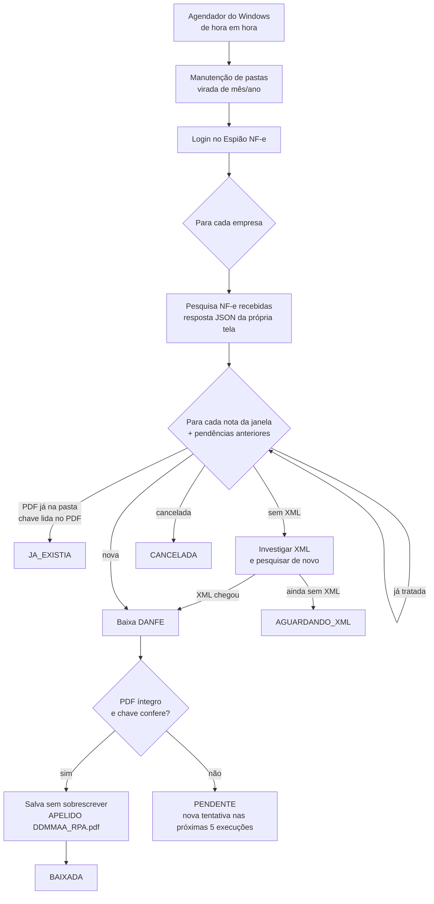

# RPA NF Espião

[](https://github.com/cesaraaugustoo/rpa-nf-espiao/actions/workflows/testes.yml)


Automação (RPA) em Python + [Playwright](https://playwright.dev/python/) que entra no
**[Espião NF-e](https://app.espiaonfe.com.br)**, encontra as notas fiscais eletrônicas recebidas
por cada empresa, baixa o **DANFE em PDF** e salva cada um na pasta do mês da loja certa, com o
nome no padrão da empresa, **sem nunca baixar a mesma nota duas vezes**.

Roda sozinho pelo Agendador de Tarefas do Windows, de hora em hora, e se recupera de falhas:
site instável, nota ainda sem XML, OneDrive ocupado, virada de mês e de ano.

---

## Sumário

- [O que ele faz](#o-que-ele-faz)
- [Como funciona](#como-funciona)
- [Garantias](#garantias)
- [Requisitos](#requisitos)
- [Instalação](#instalação)
- [Configuração](#configuração)
- [Uso](#uso)
- [Agendamento](#agendamento)
- [Logs, pendências e conferência](#logs-pendências-e-conferência)
- [Estrutura do projeto](#estrutura-do-projeto)
- [Testes](#testes)
- [Segurança e dados sensíveis](#segurança-e-dados-sensíveis)
- [Documentação complementar](#documentação-complementar)

---

## O que ele faz

Em cada execução, para **cada empresa configurada**:

1. Pesquisa no Espião as NF-e **recebidas**: por padrão, as emitidas hoje e ontem. Se o computador
   ficou desligado ou o site ficou fora do ar, cobre **todo o intervalo** desde a última pesquisa
   completa daquela empresa, e nenhuma nota fica para trás.
2. Ignora as que já foram tratadas e as que **já estão na pasta**. Para isso, lê a chave de acesso
   dentro dos PDFs existentes, inclusive os salvos à mão com qualquer nome.
3. Baixa *Download Danfe em PDF*, confere que é um PDF íntegro **da nota certa** e salva como:

   ```
   NOTAS FISCAIS\2026\OUTUBRO 26 - LOJA CENTRO\ACME 231026_RPA.pdf
                                               ACME 231026 2_RPA.pdf   <- 2ª nota do mesmo fornecedor no dia
   ```

4. Registra tudo num log TXT diário e num banco de controle local.

Além disso:

- **Virada de mês:** os meses fechados vão para `<ano>\<ano>\` e as pastas do mês novo são criadas.
- **Virada de ano:** o ano anterior é "achatado" (`<ano>\<ano>\*` volta para `<ano>\`) e nasce a
  pasta do ano novo.
- **Nota sem XML:** quando a SEFAZ só entregou o resumo, o RPA aciona **Investigar XML** (o Espião
  busca o XML na SEFAZ na hora), pesquisa de novo e baixa no mesmo ciclo. Se ainda não houver XML,
  a nota fica em espera e é tentada de novo a cada execução.
- **Download que falhou:** é tentado de novo nas **5 execuções seguintes**; depois disso vira
  pendência manual, destacada no log.

## Como funciona



Detalhes de projeto, máquina de estados e particularidades do site: [docs/arquitetura.md](docs/arquitetura.md).

## Garantias

| Garantia | Como é assegurada |
|---|---|
| Não baixa a mesma NF duas vezes | Banco de controle por chave de acesso **e** leitura da chave dentro dos PDFs que já estão na pasta |
| Não salva a nota errada | O arquivo entregue pelo site precisa trazer a chave da linha clicada; o PDF é validado (cabeçalho `%PDF`, chave no conteúdo) |
| Não mistura empresas | Cada nota devolvida pela pesquisa é conferida contra o CNPJ da empresa pesquisada |
| Nunca sobrescreve arquivo | Gravação via arquivo temporário + `rename`, que falha se o destino existir; conflitos de pasta ficam registrados para decisão manual |
| Falha do site não perde nota | Erro de pesquisa não gasta tentativas; a nota volta na execução seguinte |
| Computador desligado não perde nota | A janela recua até a última pesquisa completa de cada empresa (limite do site: 29 dias) |
| Uma execução por vez | Trava de arquivo: uma execução agendada não começa se a anterior ainda estiver rodando |

## Requisitos

- Windows 10/11, ou Linux num servidor (veja [deploy/vps/](deploy/vps/README.md))
- Python 3.12 ou superior (testado em 3.12, 3.13 e 3.14)
- Acesso ao Espião NF-e com as empresas cadastradas
- Pasta de notas fiscais (por exemplo, no OneDrive)

## Instalação

```powershell
git clone https://github.com/cesaraaugustoo/rpa-nf-espiao.git
cd rpa-nf-espiao
powershell -ExecutionPolicy Bypass -File scripts\instalar.ps1
```

O instalador:

1. cria o ambiente Python em `%LOCALAPPDATA%\RPA_NF_ESP\venv`, fora do OneDrive;
2. instala as dependências e o Chromium do Playwright;
3. cria `.env` e `config\config.toml` a partir dos modelos;
4. roda os testes.

## Configuração

| Arquivo | Conteúdo | Versionado? |
|---|---|---|
| `.env` | `ESPIAO_USUARIO` e `ESPIAO_SENHA` | **Não** (modelo: `.env.example`) |
| `config/config.toml` | empresas, pastas, janela de dias, tentativas | **Não** (modelo: `config/config.example.toml`) |
| lista de apelidos (`.md`) | raiz do CNPJ do fornecedor → apelido | **Não** (modelo: `config/apelidos.example.md`) |
| `config/apelidos_extras.csv` | sobreposições locais de apelido | **Não** (modelo: `config/apelidos_extras.example.csv`) |

Cada opção do `config.toml` está comentada no próprio arquivo. As principais:

```toml
[execucao]
dias_retroativos = 1      # 0 = só hoje; 1 = hoje + ontem
max_retentativas = 5      # novas tentativas após uma falha de download
dias_aguardar_xml = 6     # quanto tempo vigiar uma nota "Sem XML"

[[empresas]]
cnpj = "11222333000181"
pasta = "LOJA CENTRO"     # vira "OUTUBRO 26 - LOJA CENTRO"
```

**Apelido do fornecedor** (o que vai no nome do arquivo), em ordem de precedência:

1. `apelidos_extras.csv` pelo CNPJ completo (ex.: uma filial com nome próprio);
2. `apelidos_extras.csv` pela raiz;
3. tabela confirmada da lista de apelidos;
4. seção "Apelidos sugeridos" (se `usar_sugeridos = true`);
5. sem apelido: a razão social completa do emitente.

## Uso

```powershell
EXECUTAR_AGORA.bat                         # executa agora
EXECUTAR_AGORA.bat --ensaio                # mostra o que faria, sem baixar nem mover nada
EXECUTAR_AGORA.bat --visivel               # com o navegador visível
EXECUTAR_AGORA.bat --empresa 11222333000181
EXECUTAR_AGORA.bat --somente-pastas        # só a virada de mês/ano
EXECUTAR_AGORA.bat --pendencias            # notas em aberto e desistidas
EXECUTAR_AGORA.bat --reprocessar <chave>   # devolve uma nota para a fila
EXECUTAR_AGORA.bat --conferir              # conferência Espião x pastas (29 dias)
EXECUTAR_AGORA.bat --detalhado             # log técnico, para depuração
EXECUTAR_AGORA.bat --testar-email          # e-mail de teste (alertas, ALERTA_* no .env)
EXECUTAR_AGORA.bat --resumo-do-dia         # envia agora o resumo do dia por e-mail
```

Códigos de saída: `0` ok · `1` terminou com falhas · `2` erro fatal (senha, configuração) ·
`3` outra execução já estava rodando.

## Agendamento

```powershell
# Roda de hora em hora (07:00–20:00) mesmo com o usuário deslogado, sem guardar senha.
# Exige PowerShell aberto com "Executar como administrador".
powershell -ExecutionPolicy Bypass -File scripts\agendar_tarefa.ps1

powershell -ExecutionPolicy Bypass -File scripts\agendar_tarefa.ps1 -SoLogado   # sem administrador
powershell -ExecutionPolicy Bypass -File scripts\agendar_tarefa.ps1 -ComSenha   # deslogado, com senha
powershell -ExecutionPolicy Bypass -File scripts\agendar_tarefa.ps1 -Remover
```

A tarefa roda com `pythonw` (sem janela), ignora disparos enquanto a anterior ainda roda e, se o
computador estava desligado no horário, executa quando ele ligar. Se estava suspenso, o Windows
o acorda no horário (só na tomada).

**Em servidor (VPS Linux):** para não depender do PC ligado nem do usuário logado, o RPA roda
pelo systemd e grava direto no OneDrive (rclone). Instalação, troca do PC para a VPS e volta:
[deploy/vps/README.md](deploy/vps/README.md). Só um dos dois pode estar agendado por vez.

## Logs, pendências e conferência

- `logs\rpa_AAAA-MM-DD.txt`: tudo o que cada execução fez, com um resumo por empresa.
- `logs\capturas\`: captura da tela do site no momento de cada erro.
- `logs\conferencia_*.txt`: relatório da conferência.

A **conferência** (`--conferir`) cruza tudo o que o Espião lista nos últimos 29 dias com os PDFs
das pastas, pela chave de acesso, e classifica cada nota: `OK`, `FALTANDO`, `FORA DO LUGAR`,
`DUPLICADA`, `SEM CONFIRMAÇÃO` (PDF digitalizado, sem texto), `SEM XML`, `CANCELADA`. Problemas
causados pelo RPA são marcados `[RPA]` e definem o resultado. Os demais, como arquivos salvos à
mão, aparecem como observação.

Rotina de operação e solução de problemas: [docs/operacao.md](docs/operacao.md).

## Estrutura do projeto

```
rpa-nf-espiao/
├── rpa_nf_esp/
│   ├── __main__.py      # linha de comando, trava de execução única, códigos de saída
│   ├── executor.py      # orquestração: empresa por empresa, nota por nota
│   ├── espiao.py        # automação do site (Playwright)
│   ├── conferencia.py   # conferência somente leitura Espião x pastas
│   ├── pastas.py        # pasta do mês, virada de mês e de ano
│   ├── nomes.py         # padrão de nome e gravação sem sobrescrever
│   ├── apelidos.py      # leitura da lista de apelidos
│   ├── pdf.py           # validação do DANFE e índice de chaves dos PDFs
│   ├── ledger.py        # banco de controle (SQLite)
│   ├── documentos.py    # validação de CNPJ e chave de acesso
│   ├── config.py        # carga e validação da configuração
│   └── logs.py          # log TXT diário
├── config/              # modelos de configuração (os reais não são versionados)
├── scripts/             # instalação e agendamento (PowerShell)
├── deploy/vps/          # serviços systemd e guia para rodar numa VPS Linux
├── tests/               # testes automatizados (dados 100% fictícios)
├── docs/                # arquitetura e operação
└── EXECUTAR_AGORA.bat   # execução manual
```

## Testes

```powershell
"%LOCALAPPDATA%\RPA_NF_ESP\venv\Scripts\python.exe" -m pytest
```

Os testes cobrem as regras de negócio: dígitos verificadores, apelidos, padrão de nome e
sequência, gravação sem sobrescrever, virada de mês e de ano, conflitos de pasta, falhas do
OneDrive, chave citada de outra nota, retentativas, "Sem XML" e site fora do ar (com um Espião
simulado). Rodam no GitHub Actions em Windows e Linux com Python 3.12, 3.13 e 3.14. **Todos os CNPJs e
chaves de acesso dos testes são fictícios**, gerados com dígito verificador válido.

## Segurança e dados sensíveis

- Credenciais ficam só no `.env`, que não é versionado.
- Configuração real, lista de fornecedores, logs, PDFs, XMLs e o banco de controle estão no
  `.gitignore`.
- O banco de controle e o ambiente Python ficam em `%LOCALAPPDATA%`, fora de pastas sincronizadas.
- Recomenda-se um **usuário exclusivo para o RPA** no Espião (*Cadastros > Usuários*): sessões
  simultâneas do mesmo usuário podem se atrapalhar.

## Documentação complementar

- [docs/arquitetura.md](docs/arquitetura.md): módulos, fluxo, estados das notas, decisões de
  projeto e particularidades do site.
- [docs/operacao.md](docs/operacao.md): rotina, pendências, conferência, virada de mês/ano e
  solução de problemas.
- [CHANGELOG.md](CHANGELOG.md): histórico de versões.
