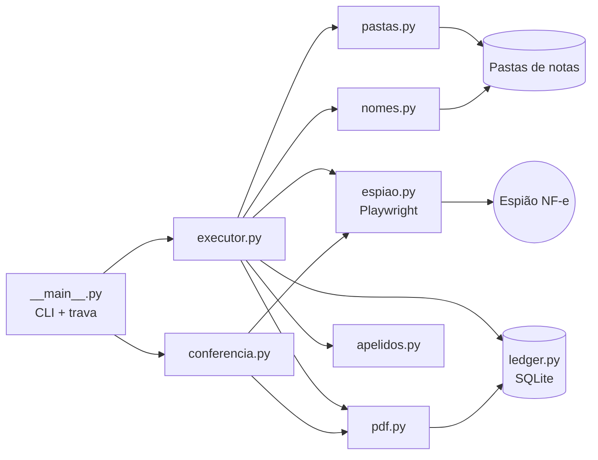
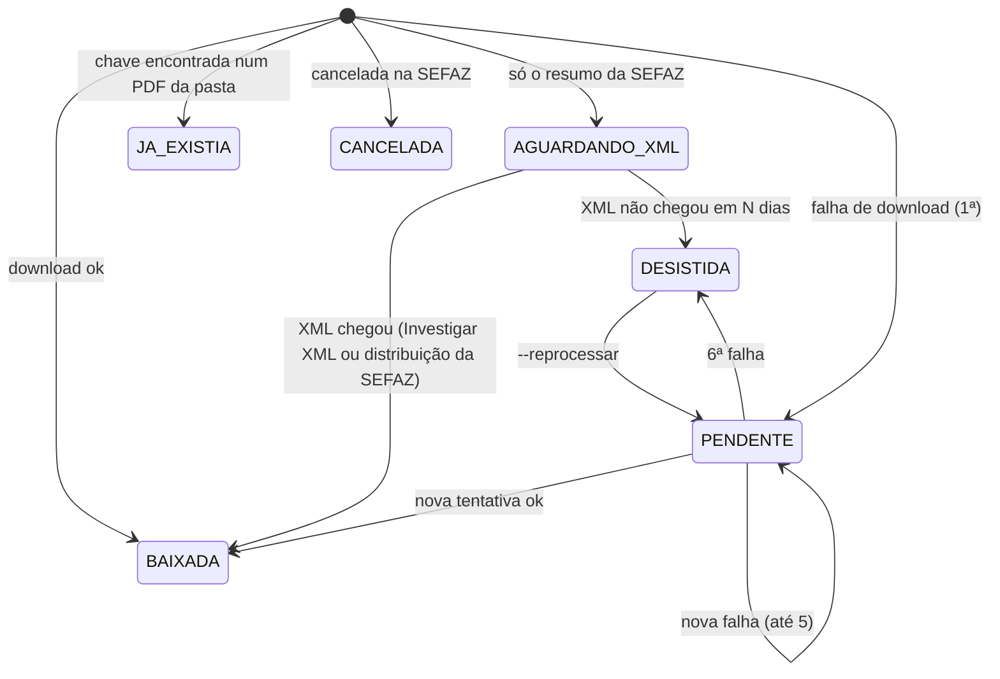

# Arquitetura

Este documento explica **como** o RPA funciona e **por que** cada decisão foi tomada. Para a
operação do dia a dia, veja [operacao.md](operacao.md).

## Visão geral



| Módulo | Responsabilidade | Depende do site? |
|---|---|---|
| `__main__.py` | argumentos, trava de execução única, códigos de saída | não |
| `executor.py` | fluxo de uma execução: manutenção → login → empresa → nota | indiretamente |
| `espiao.py` | toda interação com o site (login, pesquisa, download) | **sim** |
| `conferencia.py` | conferência somente leitura Espião x pastas | indiretamente |
| `pastas.py` | localizar/criar pasta do mês; virada de mês e de ano | não |
| `nomes.py` | padrão de nome, sequência ` 2`/` 3`, gravação atômica | não |
| `pdf.py` | validar DANFE baixado; índice de chaves dos PDFs da pasta | não |
| `apelidos.py` | lista de apelidos (markdown) + sobreposições (CSV) | não |
| `ledger.py` | estado persistente de cada nota e de cada execução | não |
| `documentos.py` | dígito verificador de CNPJ e chave de acesso | não |

Tudo o que depende do site está isolado em `espiao.py`. Se o Espião mudar de layout, é o único
módulo a ajustar, e as regras de negócio continuam cobertas pelos testes.

## Fluxo de uma execução

1. **Trava:** `rpa.lock` em `%LOCALAPPDATA%` impede duas execuções simultâneas.
2. **Manutenção de pastas:** virada de mês/ano e criação das pastas do mês. Um erro aqui
   (ex.: OneDrive ocupado) é registrado e **não impede** os downloads.
3. **Apelidos:** lidos da fonte configurada; a cópia local é atualizada (plano B).
4. **Login:** até 3 tentativas para falhas passageiras; senha recusada encerra na hora.
5. **Por empresa:**
   - calcula a janela (ver [Janela sem lacunas](#janela-sem-lacunas)) e inclui as notas em aberto de
     execuções anteriores, ampliando o período da pesquisa se preciso;
   - pesquisa (com uma nova tentativa após recarregar a tela);
   - para cada nota alvo: dedup → cancelada? → já na pasta? → sem XML? → baixa → valida → grava;
   - para as notas "Sem XML": aciona *Investigar XML*, pesquisa de novo e baixa as que passaram a ter XML.
6. **Resumo:** por empresa no log; situação da execução no ledger.

## Janela sem lacunas

O ledger guarda, por empresa, o primeiro e o último dia de **pesquisa completa** (tabela `cobertura`).
O início da janela de cada execução é:

```
inicio = min(hoje, último dia coberto) - dias_retroativos      (limitado a 29 dias pelo site)
```

- **Execução horária normal:** o último dia coberto é hoje, e a janela fica em hoje + ontem.
- **Primeira execução do dia:** o último dia coberto é ontem, e a janela inclui anteontem. Isso
  cobre a nota de anteontem que só entrou no Espião depois da última execução de ontem.
- **Computador desligado ou suspenso, internet ou site fora do ar:** a cobertura não avança, e a
  próxima execução bem-sucedida recua até ela (fica registrado um AVISO no log).
- **Mais de 29 dias sem execução:** cobre o máximo do site e registra ERRO pedindo conferência manual.

Por que isso importa: no estudo de 29 dias (237 notas dos 4 CNPJs), 92% das notas entraram no
Espião no dia da emissão e 8% no dia seguinte (XML muitas vezes de madrugada), nenhuma depois disso.
O atraso da SEFAZ cabe na margem de 1 dia. O risco real é o computador ficar desligado ou
suspenso, por exemplo num fim de semana: houve 14 notas emitidas em sábado e domingo no período.

A cobertura só avança quando a pesquisa da empresa termina. Notas que falham no download já ficam
no ledger como `PENDENTE`, com o próprio mecanismo de novas tentativas.

## Estados de uma nota (ledger)



Regras de contagem:

- **Só falha de download conta tentativa.** Falha na *pesquisa* (site fora do ar, sessão
  disputada) não conta: a nota volta intacta na execução seguinte.
- **"Sem XML" não é falha:** em cada execução o RPA aciona *Investigar XML* e, se o XML não vier,
  a nota segue vigiada por até `dias_aguardar_xml` dias, sem gastar tentativas. Uma falha ao
  investigar (botão ausente, janela diferente) só gera um AVISO.
- Estados finais (`BAIXADA`, `JA_EXISTIA`, `CANCELADA`) nunca são reprocessados automaticamente.

## Deduplicação em duas camadas

1. **Ledger:** chave de acesso já registrada como `BAIXADA`/`JA_EXISTIA` → pula.
2. **Conteúdo das pastas:** a chave de acesso está impressa no DANFE. O RPA lê o texto dos PDFs
   da pasta de destino e reconhece a nota mesmo que tenha sido salva à mão, com qualquer nome.
   O resultado fica em cache no ledger por *caminho + tamanho + data de modificação*.

Detalhes que evitam falso positivo e falso negativo:

- **Chave citada:** um DANFE pode citar a chave de *outra* nota (ex.: "DF-e Ref." em Informações
  Complementares). O índice considera só a **chave própria**: com uma chave no texto, é ela; com
  várias, vale a que tem o número da NF impresso no cabeçalho; se for ambíguo, o arquivo é tratado
  como ilegível, nunca como prova de que outra nota já está salva.
- **Falha de leitura não entra no cache:** um arquivo "somente online" do OneDrive com o OneDrive
  fechado é relido na execução seguinte, em vez de ficar marcado como "sem chave".
- **PDF digitalizado** (sem texto) não tem chave legível. Se houver um com o mesmo nome esperado,
  o RPA baixa o DANFE oficial mesmo assim (`... 2_RPA.pdf`) e registra um **AVISO**: uma cópia a
  mais é preferível a uma nota não salva.

Se o banco de controle for perdido, a camada 2 sozinha impede downloads repetidos de PDFs legíveis.

## Nomes e gravação

- `APELIDO DDMMAA<sufixo>.pdf`; a 2ª, 3ª… nota do mesmo fornecedor no mesmo dia recebe ` 2`, ` 3`.
- A sequência considera arquivos manuais e compara **sem acento e sem caixa**
  (`CAFE BOM` = `CAFÉ BOM`).
- Caracteres inválidos no Windows são removidos (`/` vira `-`), nomes reservados (`CON`, `PRN`…) são
  protegidos e o tamanho é limitado.
- **Gravação atômica:** cópia para um temporário oculto na própria pasta e `os.rename` para o nome
  final. No Windows, o rename falha se o destino existir, o que fecha a janela de corrida. O
  temporário é sempre removido, mesmo em erro.

## Pastas: mês corrente, arquivo do ano e anos anteriores

```
NOTAS FISCAIS\2026\OUTUBRO 26 - LOJA CENTRO           <- mês corrente, solto no ano
NOTAS FISCAIS\2026\2026\SETEMBRO 26 - LOJA CENTRO     <- meses fechados do ano corrente
NOTAS FISCAIS\2025\DEZEMBRO 25 - LOJA CENTRO          <- anos anteriores, achatados
```

- A pasta de uma nota é a do **mês de emissão**, onde quer que ela esteja. Uma nota de 31/10
  tratada em 01/11 vai para a pasta arquivada de outubro.
- Pastas existentes são encontradas por comparação tolerante (sem acento, espaço ou pontuação) e
  por apelidos de pasta (`aliases_pasta`), para aceitar grafias antigas.
- Só pastas com nome de mês são movidas. Qualquer outra (`TESTE`, pastas de outras ferramentas)
  nunca é tocada.
- Conflito de nome nunca sobrescreve: conteúdos são mesclados arquivo a arquivo, e um arquivo em
  conflito fica registrado como `CONFLITO` para decisão manual.
- Tudo é idempotente: rodar de novo não muda nada.

## Particularidades do site (e como foram tratadas)

| Particularidade | Tratamento |
|---|---|
| A pesquisa responde com um JSON em base64 (POST `espiaoCtrl`, ação `pesqNfe`) | A lista de notas vem dessa resposta, capturada no clique em *Pesquisar*. Ela diz exatamente quais notas existem, inclusive "nenhuma", sem depender de tempo de renderização. Se o formato mudar, cai para a leitura da tabela, achando as colunas pelo **texto do cabeçalho** (as colunas são reordenáveis pelo usuário). |
| Ao carregar, a tela restaura de forma assíncrona a última empresa usada **pela conta** | Espera a tela estabilizar; cada tentativa de seleção é independente e conferida depois de uma pausa; confere de novo antes de pesquisar; e cada nota devolvida é validada contra o CNPJ pedido. |
| Depois de um download, o menu MUI deixa `aria-hidden="true"` no `#root` | Botões são localizados por CSS e texto, nunca por papel de acessibilidade (`get_by_role` deixaria de encontrá-los). |
| O arquivo baixado se chama `<chave>-danfe.pdf` | Se a chave não for a da linha clicada, o download é descartado. |
| O período é um *DateRangePicker* que não aceita digitação confiável | Usa os atalhos (*Hoje*, *Últimos 7 dias*, *Últimos 30 dias*), o menor que cobre o período, e confere o valor aplicado. |
| A sessão não sobrevive a `storage_state` | Login a cada execução (cerca de 6 s). |
| Notas "Sem XML" não têm botão de download | O RPA clica em *Investigar XML* (`a[aria-label='Investigar XML']`), espera o resgate, fecha a janela em *Fechar* e pesquisa de novo. Durante isso, o fechador automático de janelas é suspenso. Sem XML ainda, viram `AGUARDANDO_XML`. |

## Decisões de infraestrutura

- **Ambiente Python e banco de controle em `%LOCALAPPDATA%`**, fora do OneDrive: evita sincronizar
  milhares de arquivos e o risco de lock/corrupção de SQLite numa pasta sincronizada.
- **`pythonw` no Agendador:** sem janela piscando; o log trata `sys.stdout = None`.
- **Modo S4U** no Agendador: roda com o usuário deslogado sem guardar senha (não precisa de
  recursos de rede autenticados; usa só internet e disco local).
- **Logs TXT diários** com retenção configurável (padrão 90 dias), legíveis por qualquer pessoa.
